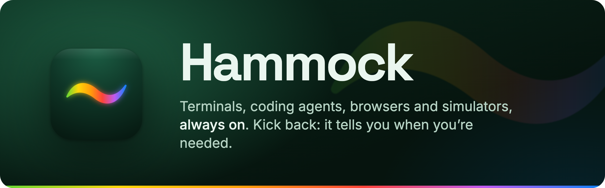

<p align="center">
  
</p>

<p align="center">
  <a href="https://homegrownsw.com/hammock/"><b>Website</b></a> ·
  <a href="https://homegrownsw.com/hammock/download"><b>Download for Mac</b></a> ·
  <a href="docs/product-spec.md">Product spec</a> ·
  <a href="docs/build-plan.md">Build plan</a>
</p>

# Hammock

Hammock is a fast, native Mac terminal that never loses your work. A daemon owns your shells, coding agents,
browsers and simulators, organised into Groups, tabs and panes, so they keep running whatever happens to the
window. The Mac and iPhone apps, a TUI and the `hmk` CLI all show the same workspace, and agents can drive it
too, through MCP.

| | |
|---|---|
| 🟢 **Always on** | Every pane lives in its own process: quit the app, update it or crash it, and your terminals and agents keep running. After a reboot, agents resume their sessions. |
| 🟡 **An agent cockpit** | See at a glance which agent is working, which needs you and which has finished, across every Group. |
| 🟠 **Finds you** | A notification on the Mac you're using, or on your iPhone when you're away from it. Answer from there. |
| 🔴 **More than terminals** | Chromium browser, iOS Simulator and log panes, side by side with your shells. |
| 🟣 **Agents drive it too** | Through `hmk mcp`, agents open panes, run dev servers, check pages and tap through simulators, inside their own Group. |
| 🔵 **Native, and quick** | SwiftUI on the Mac and iPhone, terminals drawn by libghostty, plus a TUI and the `hmk` CLI. |

## Install

- **Mac:** [download Hammock](https://homegrownsw.com/hammock/download) (macOS 26 or later), open it and drag Hammock
  to Applications. It updates itself.
- **iPhone:** in beta on TestFlight. Pair it with your Mac from Hammock ▸ Settings ▸ Devices.
- **Linux and Unraid:** the daemon, `hmk` and the TUI, so sessions can live on a server your Mac links to. See
  [docs/linux.md](docs/linux.md).

## Use

- **Mac app:** it starts its daemon if none is running; Hammock ▸ *Run Daemon at Login* makes that permanent.
- **TUI:** `hmk tui`: a sidebar of Groups and tabs, and split panes, with a Ctrl-B prefix (`c` tab, `%`/`"` split, `o` pane, `n`/`p` tab, `x` close, `q` quit).
- **CLI:** `hmk ls`, `hmk group new NAME`, `hmk tab new GROUP -- CMD`, `hmk split PANE`, `hmk attach PANE`, `hmk send/read PANE`, `hmk audit`. `hmk help` lists the rest.
- **Agents:** their status is detected automatically; for precise states install hooks with `hmk hooks install` (it backs up and merges your Claude Code and Codex config).
- **MCP:** add `hmk mcp` as an MCP server so your agents can open, watch and drive panes (they read your Groups and fully control the panes they open; typing into, closing or scripting other panes asks you first, and pairing, sharing, linking and the like are yours alone). The scope is a guardrail, not a sandbox: for a real boundary, use your agent harness's own sandbox.

State lives in `~/Library/Application Support/Hammock` (override with `HMK_DIR`), and settings in
`~/.config/hammock/config`.

## Build from source

Requirements: macOS 26 and Xcode 27.2 (Swift 6; the project is Xcode's JSON format), Go 1.27+, `zig` 0.17 (for
libghostty-vt), `just`, `uv` only for the DMG (`just share`, `just dmg`), and `protoc` with `protoc-gen-go` and
`protoc-gen-swift` only to regenerate protocol code.

```sh
just build          # Go binaries → bin/ (hmkd, hmk, pane-holder); builds libghostty-vt the first
                    # time, into a cache every checkout and worktree shares
just mac-dev        # dist/Hammock β.app: a development copy, with its own state, beside an installed Hammock
just beta           # build β and (re)start it
just test           # Go tests; (cd apple && swift test) for the Swift engine tests
just bench          # latency and throughput benchmarks
just linux          # Linux tarballs (amd64 and arm64); just unraid for the Unraid plugin
```

**Signing.** Put the name of a code-signing identity from your keychain (an Apple Development certificate will
do) in `.signing-identity`, which git ignores. Without one, builds are signed ad hoc: they run, but macOS forgets
their privacy grants (Accessibility, Screen Recording) at every rebuild.

**On an iPhone.** `HMK_TEAM=<your team id> just ios-device <device udid>` builds, signs and installs it. Signed by
your own team, the app needs bundle ids of your own too (`apple/iOS/Config/*.xcconfig`). Notifications on the
iPhone go through Hammock's push relay, which only reaches the official app: a build of your own needs its own
relay ([relay/push](relay/push), a Cloudflare Worker, with your APNs key), passed to the build as
`HMK_PUSH_RELAY`.

**Working on Hammock**, by hand or with a coding agent: [AGENTS.md](AGENTS.md) has how it fits together, how to
test without touching your installed copy, and what a new feature needs. Every change to the apps comes with a
release note ([release-notes/README.md](release-notes/README.md)).

## Feedback and contributing

Bugs and ideas are welcome as [GitHub issues](https://github.com/homegrownsw/hammock/issues). To report a security
problem, don't open an issue: see [SECURITY.md](SECURITY.md).

Pull requests are welcome when they're small: bug fixes and small improvements. For anything bigger, open an
issue first. [CONTRIBUTING.md](CONTRIBUTING.md) says how.

## Docs

- [Product spec](docs/product-spec.md) · [Technical spec](docs/tech-spec.md) · [Build plan](docs/build-plan.md)
- [UI direction](docs/design/ui-direction.md) · [Decision records](docs/adr/)
- [Benchmarks](docs/benchmarks.md) · [Linux and Unraid](docs/linux.md) · [Releases](release-notes/README.md)

## Licence

Hammock's code is under the [MIT licence](LICENSE). The Hammock name and icon aren't: a fork may use the
code, but not ship under the name or with the icon. Third-party work Hammock uses is credited in
[THIRD_PARTY_NOTICES.md](THIRD_PARTY_NOTICES.md).
