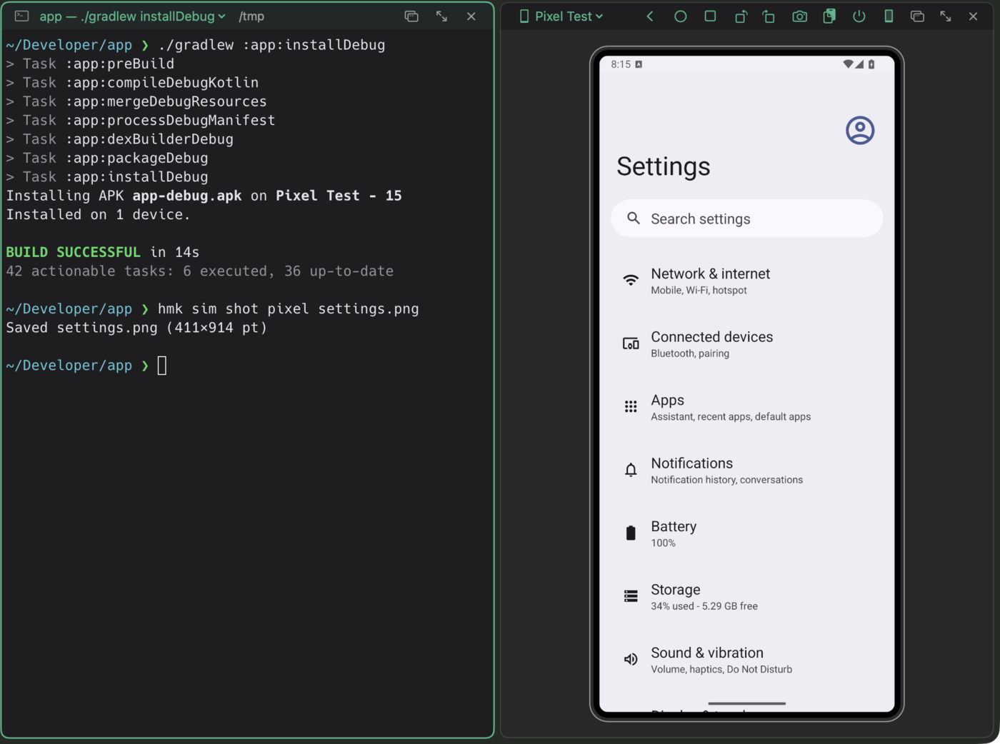
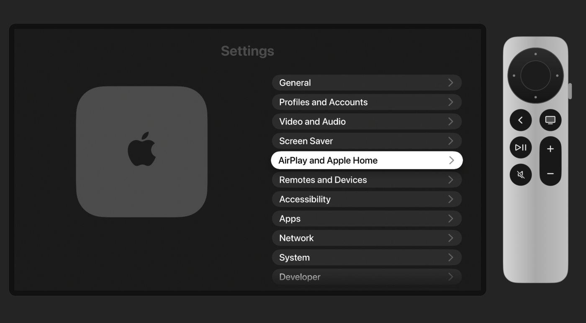

# Mac 2026.4.0

## New

- Android Emulator support: your Android Virtual Devices are listed under Android and Android TV. Agents can drive them with the same sim tools, and install apps, open links and read logcat.
  
- Apple TV Simulator support, with a Siri Remote beside the screen to click, hold and swipe. Agents can drive it with the new sim_remote tool, and hmk sim remote.
  
- Editor panes follow their file when it's renamed or moved, in the Finder or by git or an agent, instead of saying it's missing, and File ▸ Rename… renames it from the pane.
- Font menus in Settings show each font's name, and the one you've chosen, in that font.
- Hammock is a smaller download, and takes up about 55 MB less space once installed.
- Reveal in Finder for editor panes and Groups: from the File menu, the command palette and a Group's right-click menu.
- Settings ▸ Agents can keep your Mac awake while an agent is working, so a long task finishes even when you step away.

## Fixed

- The Simulator menus no longer stay empty when opened just after Hammock starts, and list Apple TVs in a section of their own.
- Browser panes are on Chromium 156.0.8078.96, with its latest security fixes.
- ⌘D splits the pane you're in, not one that had focus earlier (such as a simulator beside it).
- Some highlights followed the system's accent colour instead of your theme's: the editor's find results, remote networks, Settings' picture choices and the checkmarks in the agent and diff pickers.
- The first message in a new conversation no longer blinks out and back as it's sent.
