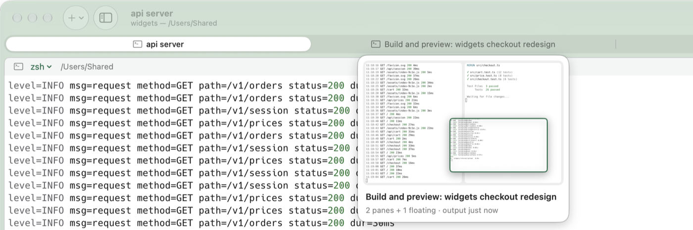

# Mac 2026.5.0

## New

- Tab Previews: rest your cursor on a tab to see a live preview of its contents.
  
- Diff panes work from the keyboard: move through lines, changes and files, comment, and press ? to see every key.
- Finish Review: tell the agent you're done with the diff, approving it or asking for changes, along with any comments not yet sent.
- Mark files viewed in a diff pane to fold them away and keep track of how far through you are.
- Markdown Preview: read a Markdown file rendered, alone or beside its source, with View ▸ Show Preview (⇧⌘V).
- Open in your editor: press e in a diff pane to edit the file at the cursor in Hammock's editor, VS Code, Zed or your terminal editor, and the diff refreshes when you close it.
- Settings looks like a small Hammock window, fully themed with your color scheme.
- Settings ▸ Tools can now turn off Scheduled Tasks, and agents' searching of past sessions, if you handle those your own way.
- The menu on a pane's name has every kind of pane under Show, including editors, diffs and logs, and asks before replacing a pane unless nothing can be lost.

## Fixed

- A resumed session's tab is named after the session, not the command that resumed it.
- Browser panes take your iPhone's size while you use them there; click the page on the Mac to make it fit the pane again.
- Agents no longer take a comment on one line of a diff as approval of the whole change.
- Alerts' highlighted buttons, and the Full Disk Access guide's, are in your theme's colour rather than always green.
- Comment on the lines a change took out, in a diff's unified layout.
- Deleting a Group with more than one tab asks first, even when nothing in it is running.
- Diffs an agent opens for you to review now appear beside its pane, like the other panes it opens, instead of in a new tab.
- Group names in the sidebar now dim with the tabs when the window isn't in front.
- Resizing a window with terminals in it is smoother.
- Scheduled tasks no longer attempt to start when a sleeping Mac wakes for a few seconds to check mail.
- Spacious panes: no line between the sidebar and the rest of the window on macOS 27.2.
- Splitting a pane only makes that pane smaller, and closing the new pane puts the layout back as it was.
- Stopping Claude Code with Esc now correctly shows it as stopped in more cases.
- The Asleep card over a sleeping agent's pane no longer bounces in every time you switch to it.
