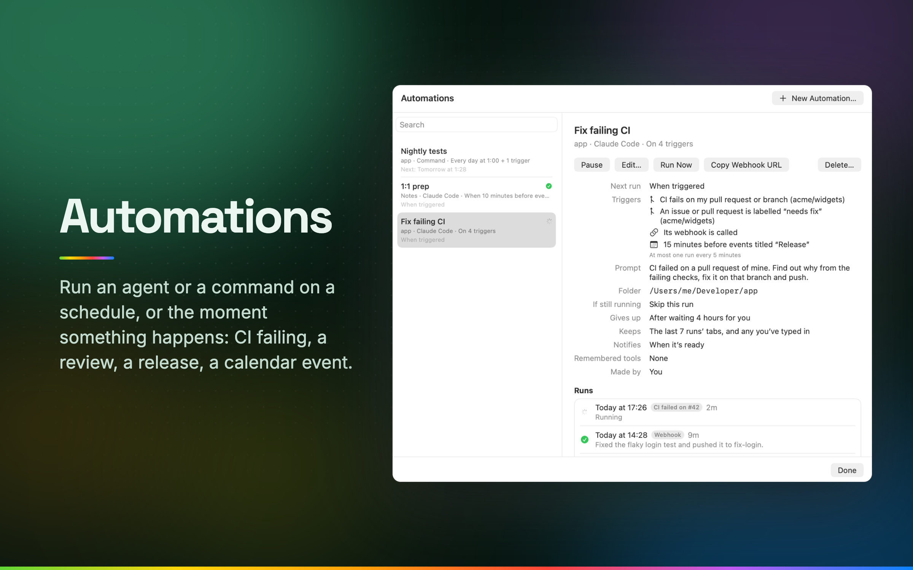
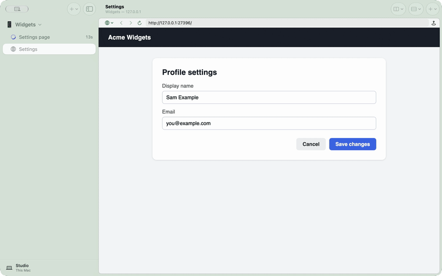

# Mac 2026.9.0

## New

- Automations: Scheduled Tasks are now Automations, and can run when something happens, such as CI failing on your pull request, a review, an agent finishing, a command failing, a log line, files changing, a calendar event or a webhook.
  
- Design Notes: pin numbered notes on a browser page or simulator screen, then send them to an agent in one message with an annotated screenshot.
  
- Continue after a usage limit: an agent that stops at its usage limit is sent "continue" once the limit resets.
- Shared Drafts: what you type in an agent's message box shows on your iPhone and other devices too, so you can start a message here and finish it there.
- Worktrees: start an agent in a new git worktree from New Agent Tab…, see each tab's pull request in the sidebar, and remove the worktree once its branch is merged.

## Fixed

- Agent view: compacting a Claude Code conversation shows "Compacting conversation…" while it runs.
- Claude's question review: before you submit, each question is listed with its answer under it, not run together in one block of text.
- Codex: a turn that ends on an error, such as its usage limit, shows as errored instead of still working.
- Screen sharing: a phone that comes back to your screen after a moment away gets a sharp picture straight away.
- Terminals: images, resizing and scrollback behave more reliably, and busy output draws faster, with the latest Ghostty.
- Text pasted into an agent's message box no longer brings its colours, links or fonts with it.
- The agent view no longer draws a finished background command's note over the rows around it.
- Updating Hammock no longer sometimes closes panes that were running at the time.
